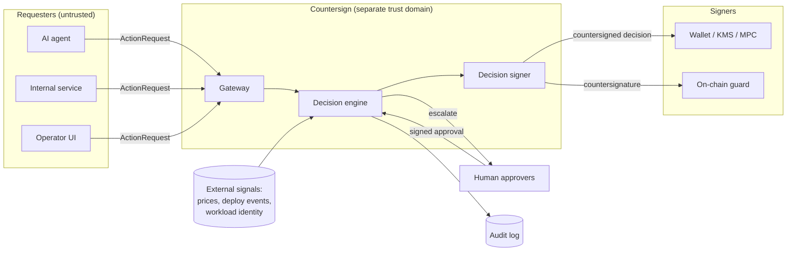
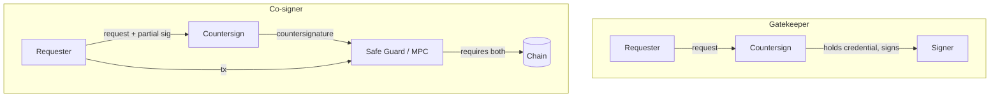
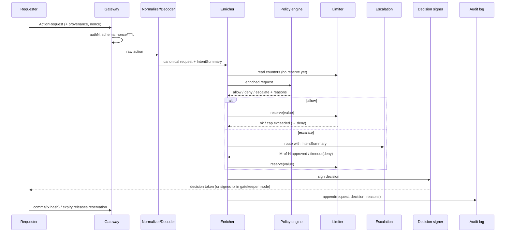

# Countersign — High-Level Design

| | |
|---|---|
| Version | 0.1 (draft) |
| Date | 2026-11-02 |
| Related | [PRD](PRD.md) · [LLD](LLD.md) |

---

## 1. Design goals

1. **Independent verification of intent** between any requester and any signer.
2. **Unbypassable when it matters** — enforcement modes where the signer cannot act without Countersign.
3. **Deterministic and replayable** — every decision reproducible from request + policy version + state snapshot.
4. **Small trusted core** — the decision path is minimal; integrations live outside it.

## 2. System context

## 3. Enforcement modes

The security of the system depends entirely on which mode is used. This is the most important design decision for each deployment.

| Mode | How it works | Bypass possible? | Use |
|---|---|---|---|
| **Advisory** | Requester asks Countersign, then calls signer itself | Yes | Dev, shadow-mode rollout |
| **Gatekeeper** | Countersign holds the signer credential (local key, KMS role, Turnkey API key). Requester never has it. | Only by compromising Countersign | Phase 1 default for agent wallets |
| **Co-signer** | Signer requires Countersign's signature: 2-of-2 multisig, Safe Guard contract verifying an EIP-712 decision, or an MPC key share held by Countersign | Only by compromising Countersign *and* the requester's key | Phase 4, custody/exchange |

## 4. Components

| Component | Responsibility | Trust level |
|---|---|---|
| **Gateway** | AuthN of requester (mTLS / workload identity / API key), schema validation, nonce + TTL checks, rate-limit on API | Core |
| **Normalizer** | Converts raw inputs (EVM tx, tool call, withdrawal) into canonical `ActionRequest` | Core |
| **Decoder / Intent renderer** | Decodes payload to `IntentSummary` with risk flags; renders plain language | Core (decoders fuzzed) |
| **Enricher** | Adds USD value (price oracle), balances, velocity counters, provenance, workload deploy age | Core; external inputs treated as untrusted with staleness bounds |
| **Policy engine** | Evaluates Cedar policies over enriched request → allow/deny/escalate + reasons | Core |
| **Limiter** | Stateful sliding-window caps with reserve/commit; circuit breaker | Core |
| **Escalation service** | Routes to approvers, collects M-of-N signed approvals, timeouts | Core |
| **Decision signer** | Signs decision token / countersignature with key in KMS/HSM/TEE | Most sensitive |
| **Signer adapters** | Gatekeeper connections to local key, AWS KMS, Turnkey, Privy | Edge |
| **Audit log** | Hash-chained append-only store; Merkle checkpoints; optional Rekor anchoring | Core |
| **Provenance SDK** | In-agent library labelling inputs and attaching taint to requests | Runs in untrusted requester; its labels are *claims* |
| **Corpus + replay harness** | Attack library; replays against policy bundles in CI | Offline |
| **CLI / Admin** | init, policy test/apply, approvals, audit verify | Operator |

### Note on provenance trust

The Provenance SDK runs inside the requester. A fully compromised requester can lie about taint. Therefore:
- Taint labels can only **add restriction**, never grant permission. Absence of taint is never treated as proof of safety.
- Hard caps and allowlists apply regardless of provenance claims.
- Phase 3 moves taint enforcement into the sandbox binding layer (outside the model's control); Phase 4 adds infrastructure-observed provenance (deploy events, workload identity) that the requester can't forge.

## 5. Decision pipeline

**Ordering rationale:** the limiter reserves only after policy says allow (or approval granted) to avoid denial-of-wallet via reservations, and reservation happens before signing to make caps race-safe.

## 6. Key flows

### 6.1 Agent wallet transfer (Phase 1)

1. Agent reads a tweet / NFT metadata → SDK labels it `untrusted_onchain` (+ `decoded` if model decoded an encoding).
2. Agent proposes `transfer 50,000 DRB → 0xabc…`.
3. SDK attaches context taint; sends to Countersign.
4. Decoder: ERC-20 transfer, destination never seen before.
5. Policy: `forbid when tainted(untrusted_*) && destination not in allowlist` → **deny**.
6. Audit entry written; agent receives a structured denial reason it can surface to its user.

### 6.2 Code-mode agent (Phase 3)

1. Model writes a script calling `crm.export()` then `email.send(external)`.
2. Sandbox bindings are Countersign-instrumented; each call is an `ActionRequest` with field-level taint (`crm.export` output labelled `sensitive_internal`).
3. `email.send` with tainted payload to external domain → **deny**, script receives exception.
4. Loop detection: N calls of the same binding in one script counted against velocity caps.

### 6.3 Exchange hot-wallet withdrawal (Phase 4)

1. Withdrawal service (workload identity `spiffe://ex/withdraw`) submits withdrawal.
2. Enricher: deploy events show new code on the signing path 4 hours ago (`minutes_since_code_change = 240`).
3. Policy: high-value withdrawal within 24h of code change → **escalate** to M-of-N.
4. Independently, tenant circuit breaker caps aggregate outflow per hour → a compromised service can't exceed it even if approvals are socially engineered.
5. Co-signer: on-chain guard / MPC share requires Countersign signature; a compromised container can't produce it.

## 7. Deployment topologies

| Topology | Description | Trust separation | Phase |
|---|---|---|---|
| **Sidecar** | Single binary next to the agent; embedded state (bbolt) | Weak — same host | 1 (dev) |
| **Self-hosted service** | Separate container/VM; Postgres + Redis; agent reaches it via mTLS | Medium — separate runtime and credentials | 1–3 |
| **Isolated trust domain** | Separate cloud account / network; decision key in HSM or TEE (e.g. Nitro Enclave); separate admins; break-glass M-of-N | Strong | 4 |

## 8. Threat model (summary)

| Adversary capability | Example | Primary controls |
|---|---|---|
| Controls agent context | Prompt injection, encoded payloads | Provenance taint, allowlists, caps |
| Controls requester process | Compromised service container (Binance) | Gatekeeper/co-signer mode, caps, circuit breaker, deploy correlation |
| Controls operator UI | Bybit-style UI swap | Independent intent rendering; approvals bound to payload hash |
| Agent error (no adversary) | OpenClaw | % of balance caps, escalation |
| Malicious insider changes policy | Raise caps before attack | M-of-N policy changes, policy-change audit, cooling-off period for cap increases |
| Replays old approval | Reuse decision token | Nonce, TTL, payload-hash binding |
| Compromises Countersign host | — | Isolated trust domain, co-signer mode (needs two compromises), minimal surface, external audit |
| Stale/manipulated prices | Oracle attack to under-value transfer | Multiple sources, staleness bound → escalate, caps also on token count |
| DoS on Countersign | Flood requests | Fail closed (safety over liveness); per-requester API limits; HA in Phase 4 |
| Address poisoning | Look-alike destination | Similarity detection vs. known destinations → escalate |

Full STRIDE table maintained in LLD §14.

## 9. Failure behaviour

- Any internal error, timeout, stale dependency → **deny** with reason `FAIL_CLOSED_<component>`.
- Break-glass: M-of-N signed override producing a time-boxed allow-policy; loudly audited.
- Limiter store unavailable → deny (never "allow without counting").

## 10. Technology choices

| Area | Choice | Why |
|---|---|---|
| Core service | Go | Simple concurrency, static binary, strong crypto libs, fast to ship solo |
| Policy | Cedar (cedar-go) | Analyzable, deny-overrides semantics, open spec; avoids inventing a DSL |
| State | bbolt (sidecar), Postgres + Redis (service) | Embedded for dev; durable + atomic counters for prod |
| EVM | go-ethereum ABI + 4byte selector DB | Mature decoding |
| SDKs | TypeScript, Python | Where agent builders are |
| Audit anchoring | Sigstore Rekor (optional) | Public transparency log without a blockchain |
| Keys | Local (dev), AWS KMS, Turnkey; HSM/Nitro Enclave Phase 4 | Progressive hardening |
| Observability | OpenTelemetry, Prometheus | Standard |

## 11. Out of scope for this HLD

Hosted SaaS architecture, billing, multi-region HA (Phase 4+).
